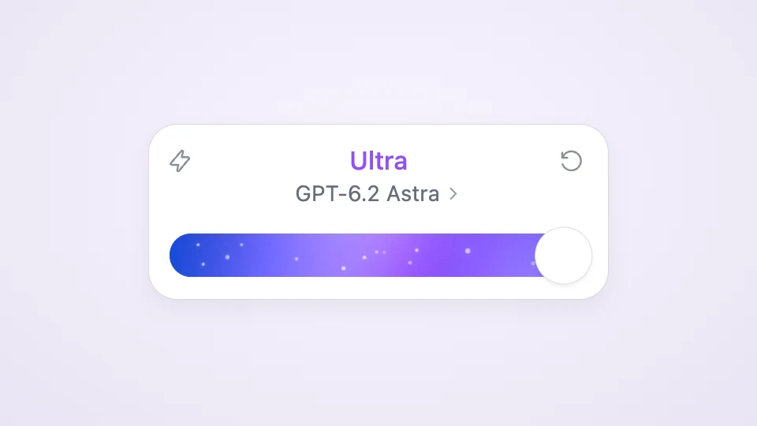
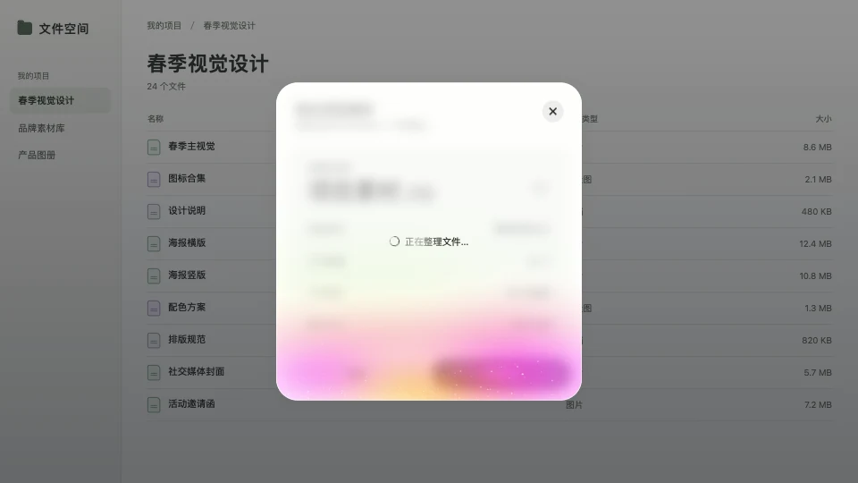
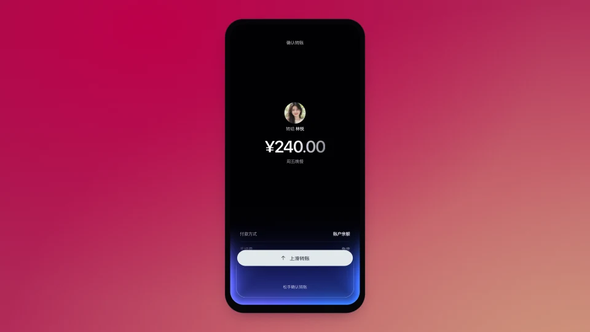

<h1 align="center">
  
</h1>

<strong>开源 UI 微交互资料库</strong>

从滑块、状态提示到加载与手势确认，每个案例都提供界面源码与动效拆解。

  <a href="#案例画廊">案例画廊</a> · <a href="#资料索引">资料索引</a> · <a href="./LICENSE">Apache 2.0</a>

## 案例画廊

<table>
  <tr valign="top">
    <td width="50%">
       
      <strong>Codex Ultra 能量滑轨</strong> 
      弹簧旋钮、极光填充与挡位粒子反馈。 
      <a href="./01-codex-ultra-slider/">案例资料</a> · <a href="./assets/01-codex-ultra-slider.mp4">MP4 演示</a>
    </td>
    <td width="50%">
       
      <strong>Agent Orb</strong> 
      用同一个 WebGL 点阵球表达六种 Agent 状态。 
      <a href="./02-agent-orb/">案例资料</a> · <a href="./assets/02-agent-orb.mp4">MP4 演示</a>
    </td>
  </tr>
  <tr valign="top">
    <td width="50%">
       
      <strong>导出光带</strong> 
      暖色光带上移，文件摘要逐行恢复清晰。 
      <a href="./03-webgl-loading/">案例资料</a> · <a href="./assets/03-webgl-loading.mp4">MP4 演示</a>
    </td>
    <td width="50%">
       
      <strong>上滑转账</strong> 
      上滑越过确认阈值，松手后衔接光箭与折射回执。 
      <a href="./04-swipe-send/">案例资料</a> · <a href="./assets/04-swipe-send.mp4">MP4 演示</a>
    </td>
  </tr>
</table>

## 资料索引

| 案例 | 界面源码 | 原理笔记 |
| --- | --- | --- |
| Codex Ultra 能量滑轨 | [单文件 HTML](./01-codex-ultra-slider/codex-ultra-slider.html) | [微交互原理速查手册](./01-codex-ultra-slider/Codex-Ultra-微交互原理速查手册.md) |
| Agent Orb | [界面与着色器](./02-agent-orb/index.html) · [点阵数据](./02-agent-orb/particles.js) | [六种状态与过渡](./02-agent-orb/README.md) |
| 导出光带 | [单文件 HTML](./03-webgl-loading/index.html) | [微交互原理速查手册](./03-webgl-loading/导出光带-微交互原理速查手册.md) |
| 上滑转账 | [界面入口](./04-swipe-send/index.html) · [手势与动效](./04-swipe-send/motion.js) · [光效渲染](./04-swipe-send/renderer.js) | [微交互原理速查手册](./04-swipe-send/上滑转账-微交互原理速查手册.md) |

[有谷 Yogu](https://yogu.pro) 维护 · [Apache License 2.0](./LICENSE)
