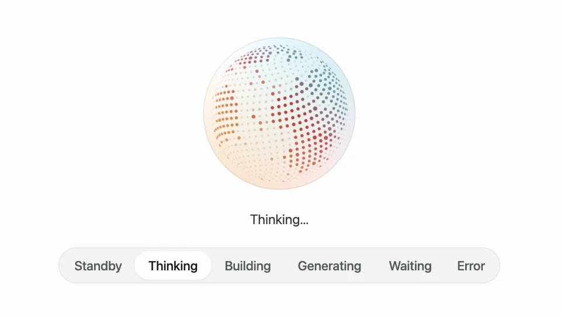
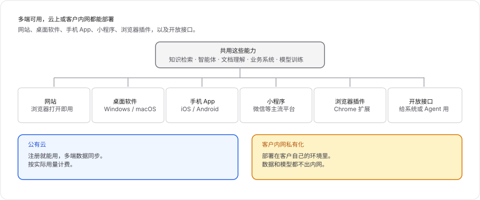
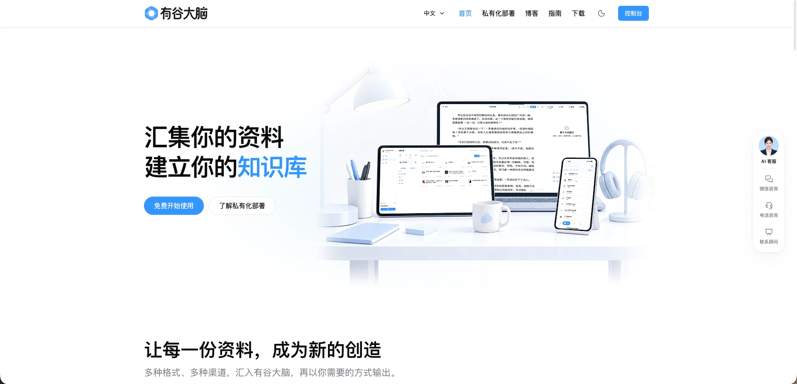
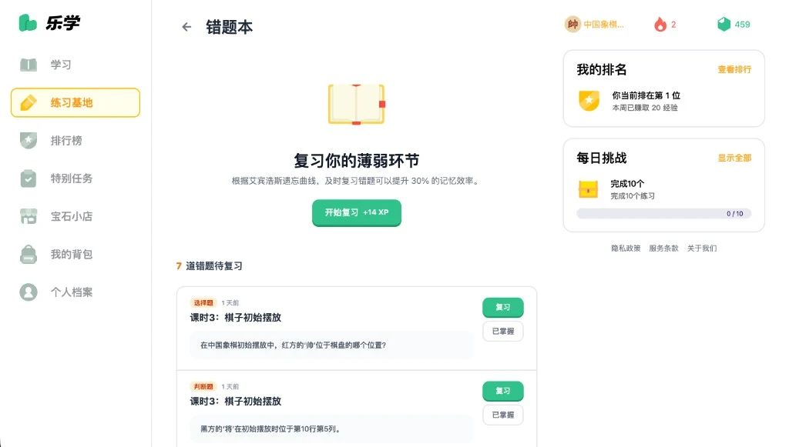

<h1 align="center">
  
</h1>

<strong>开源 UI 微交互资料库</strong>

从滑块、状态提示到加载与手势确认，每个案例都提供界面源码与动效拆解。

  <strong><a href="https://yogupro.github.io/open-motion/">在线站点</a></strong> · <a href="#案例画廊">案例画廊</a> · <a href="#资料索引">资料索引</a> · <a href="#关于智慧力量">关于智慧力量</a> · <a href="./LICENSE">Apache 2.0</a>

## 案例画廊

<table>
  <tr valign="top">
    <td width="50%">
       
      <strong>Codex Ultra 能量滑轨</strong> 
      弹簧旋钮、极光填充与挡位粒子反馈。 
      <a href="https://yogupro.github.io/open-motion/01-codex-ultra-slider/codex-ultra-slider.html">在线体验</a> · <a href="./01-codex-ultra-slider/">案例资料</a> · <a href="./assets/01-codex-ultra-slider.mp4">MP4 演示</a>
    </td>
    <td width="50%">
       
      <strong>Agent Orb</strong> 
      用同一个 WebGL 点阵球表达六种 Agent 状态。 
      <a href="https://yogupro.github.io/open-motion/02-agent-orb/">在线体验</a> · <a href="./02-agent-orb/">案例资料</a> · <a href="./assets/02-agent-orb.mp4">MP4 演示</a>
    </td>
  </tr>
  <tr valign="top">
    <td width="50%">
       
      <strong>导出光带</strong> 
      暖色光带上移，文件摘要逐行恢复清晰。 
      <a href="https://yogupro.github.io/open-motion/03-webgl-loading/">在线体验</a> · <a href="./03-webgl-loading/">案例资料</a> · <a href="./assets/03-webgl-loading.mp4">MP4 演示</a>
    </td>
    <td width="50%">
       
      <strong>上滑转账</strong> 
      上滑越过确认阈值，松手后衔接光箭与折射回执。 
      <a href="https://yogupro.github.io/open-motion/04-swipe-send/">在线体验</a> · <a href="./04-swipe-send/">案例资料</a> · <a href="./assets/04-swipe-send.mp4">MP4 演示</a>
    </td>
  </tr>
</table>

## 资料索引

| 案例 | 界面源码 | 原理笔记 |
| --- | --- | --- |
| Codex Ultra 能量滑轨 | [单文件 HTML](./01-codex-ultra-slider/codex-ultra-slider.html) | [微交互原理速查手册](./01-codex-ultra-slider/Codex-Ultra-微交互原理速查手册.md) |
| Agent Orb | [界面与着色器](./02-agent-orb/index.html) · [点阵数据](./02-agent-orb/particles.js) | [六种状态与过渡](./02-agent-orb/README.md) |
| 导出光带 | [单文件 HTML](./03-webgl-loading/index.html) | [微交互原理速查手册](./03-webgl-loading/导出光带-微交互原理速查手册.md) |
| 上滑转账 | [界面入口](./04-swipe-send/index.html) · [手势与动效](./04-swipe-send/motion.js) · [光效渲染](./04-swipe-send/renderer.js) | [微交互原理速查手册](./04-swipe-send/上滑转账-微交互原理速查手册.md) |

## 关于智慧力量

**杭州智慧力量科技有限公司**专注打造高工艺密度的 AI 产品，帮个人与团队把 AI 真正接到日常的知识工作、内容生产与业务流程中。

OpenMotion 由智慧力量维护，用于分享 UI 微交互案例、源码与原理笔记。

| 维度 | 详情 |
| --- | --- |
| **公司** | 杭州智慧力量科技有限公司 |
| **核心方向** | 知识工作与学习 · 内容与媒体生产 · 企业智能应用 |
| **产品规模** | 10 款自有标准产品（含多款公测/开放注册产品） · 2 项在建新线 |
| **部署形态** | 公有云 SaaS；支持本地私有化与内网不出网部署 |
| **支持端** | Web · Windows / macOS 桌面 · iOS / Android · 微信小程序 · Chrome 插件 · 开放 API & MCP |
| **官网** | [yogu.pro](https://yogu.pro) |

### 我们的产品矩阵

#### 1. 知识工作与学习

| 产品 | 简介 | 入口 |
| --- | --- | --- |
| **有谷大脑** | AI 知识库：多端资料存储、带出处检索问答，支持 MCP 与开放 API | [brain.yogu.pro](https://brain.yogu.pro) · [Chrome 插件](https://chromewebstore.google.com/detail/yogu-brain-extension/bpanijkknkliflcokjjnoclajokgfpbn) |
| **不难学** | AI 课程生成 + 自适应游戏化学习平台 | [lexue.pro](https://app.lexue.pro) |
| **不读** | 智能 PDF 阅读器：长篇 PDF 的持续阅读与知识留存 | [noread.pro](https://noread.pro) |
| **盘哥** | 网盘资源检索与转存 | [pan.yogu.pro](https://pan.yogu.pro) |
| **可译** | 多格式文档翻译：术语一致、版式还原、支持局部重试 | 即将开放 |
| **有谷爬虫** | 通用采集控制台：新数据源以配置方式快速接入 | 即将开放 |

#### 2. 内容与媒体生产

| 产品 | 简介 | 入口 |
| --- | --- | --- |
| **炫彩画布** | 浏览器内图像处理：抠图、放大、矢量化可串成工作流 | [design.yogu.pro](https://design.yogu.pro) |
| **有谷文档** | 一句话生成一节课课件，版式按学科教法定制，严守内容可核验红线 | 即将开放 |
| **有谷视频** | AI 讲解视频：分阶段生成，审校不过可从指定环节精准重做 | 即将开放 |

#### 3. 企业流程与数据新线

| 产品 | 状态 | 简介 |
| --- | --- | --- |
| **智能招聘面试平台** | 标准产品 | 将招聘全流程构建为可配置的智能流水线 |
| **有谷 Compass** | 在建 | 企业数据本体工作区：建模、数据源映射、对象浏览与自动化决策 |
| **有谷 APS** | 演示阶段 | 基于 Compass 对象模型的生产排产工作台：甘特排程、冲突预警与历史快照 |

### 主推产品介绍

#### 有谷大脑（[brain.yogu.pro](https://brain.yogu.pro)）

解决「资料收藏难整理、要用找不到、AI 回答与原文对不上」三大痛点：
- **多端无缝协同**：网页端集知识库、阅读器、问答、批注与工作流于一体；手机随手存、电脑接着问；Chrome 插件一键收藏网页与办公/设计原文件。
- **可溯源检索问答**：优先检索个人/团队知识库并附带原文出处，支持仅针对当前文档提问；按工作空间、知识库、文件夹、标签四层清晰隔离。
- **开放平台与 MCP**：个人版开放 API 便于衔接脚本与常用工具；团队与企业版支持通过 **MCP** 接入主流 AI 客户端，提供入库、检索、问答接口并按角色精细控权。

#### 不难学（[lexue.pro](https://app.lexue.pro)）
同时解决「教师难一次排出结构完整的课」与「学生练几天就放弃」两端问题：
- **面向教师**：按调研、结构设计、课时、脚本、题目、学习手册分步生成，支持操作级回退，局部修改无需整课重做。
- **面向学习者**：按掌握度动态匹配适宜难度与错题间隔复习，配备错题本、任务与可配置激励规则；支持手机离线练习、整页作业拍照识别批改与多组织隔离。

### 联系我们

- **官网**：[首页](https://yogu.pro) · [简介](https://yogu.pro/about) · [业务领域](https://yogu.pro/business) · [联系方式](https://yogu.pro/contact)
- **商务邮箱**：`business@yogu.pro`
- **办公地址**：浙江省杭州市余杭区梦想小镇天使村 10 幢 C 座 212（周一至周五 9:00–18:00）
