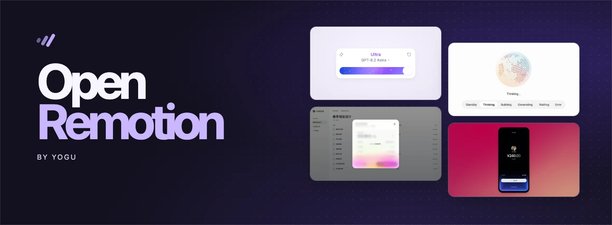
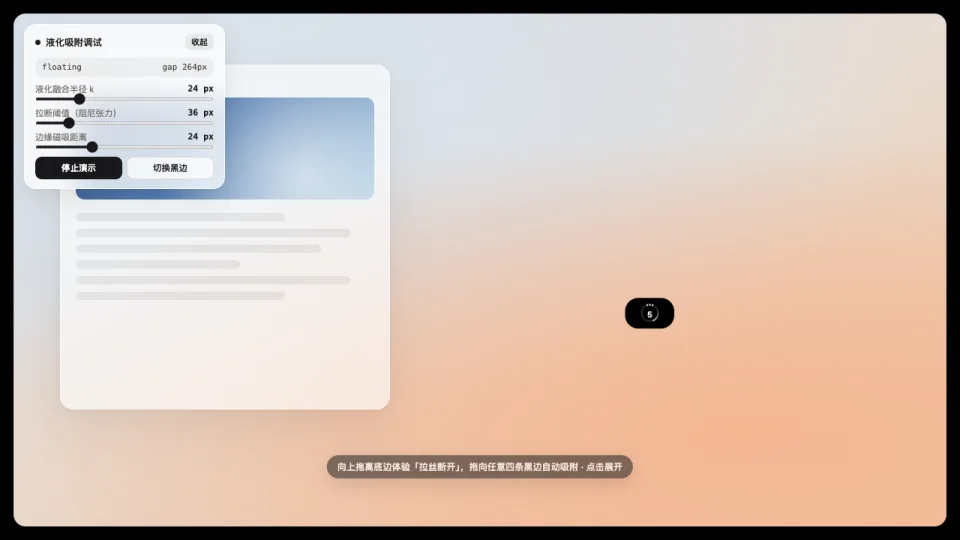
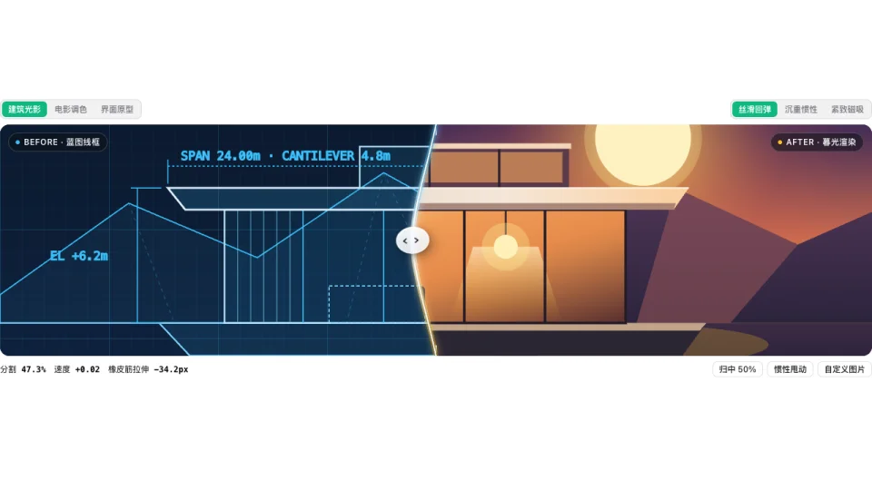
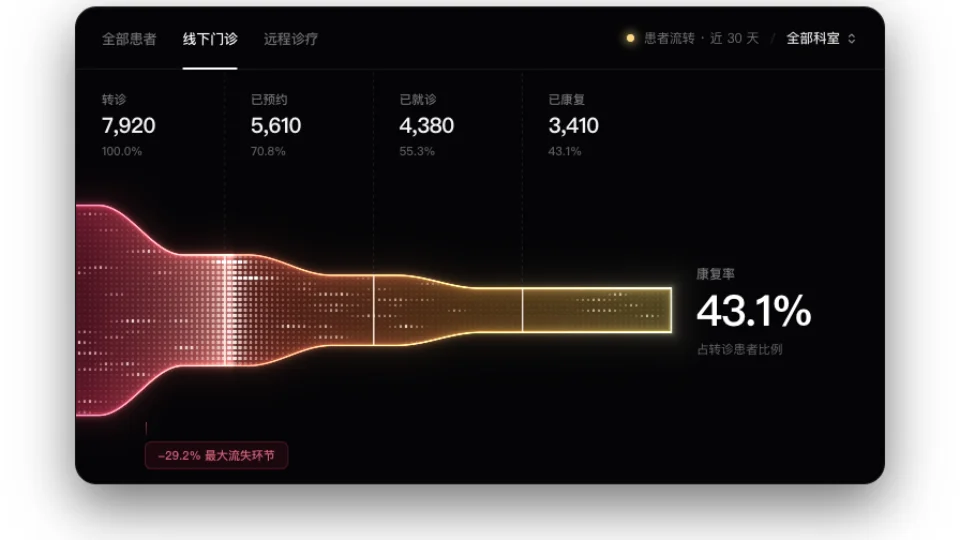
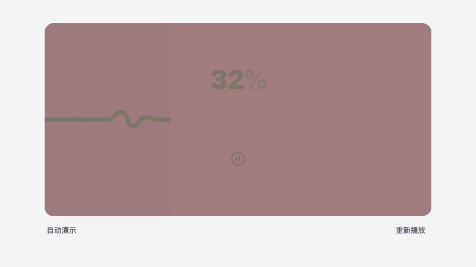
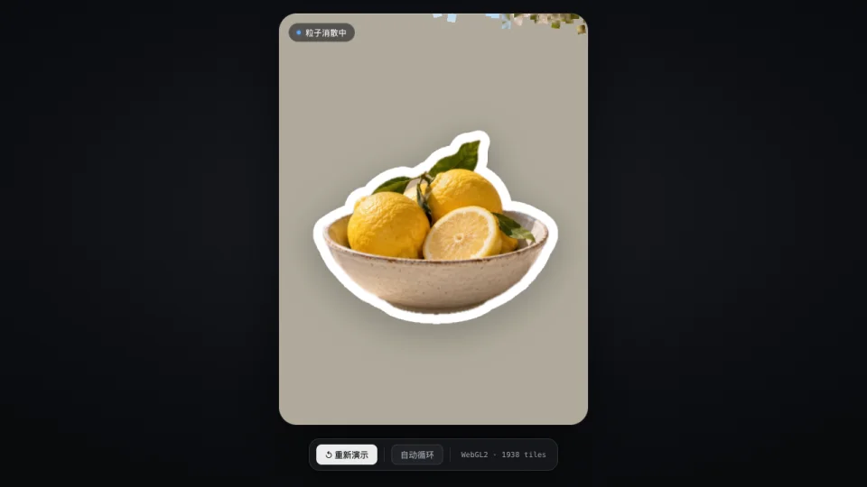
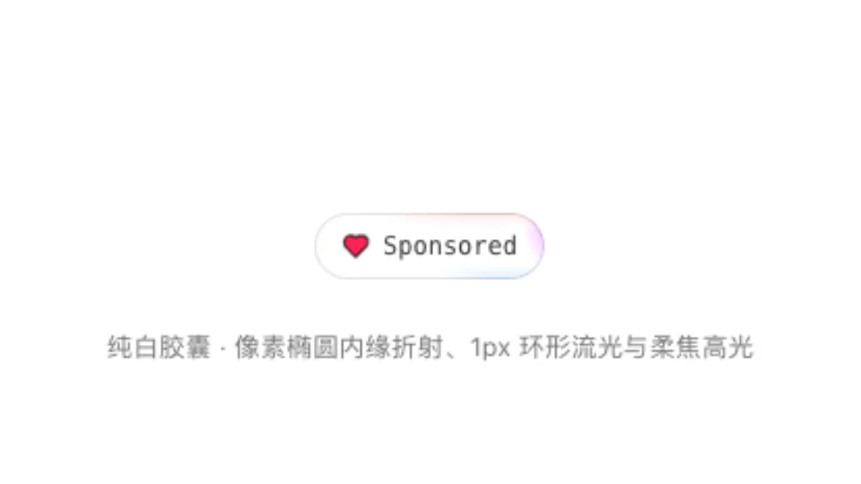
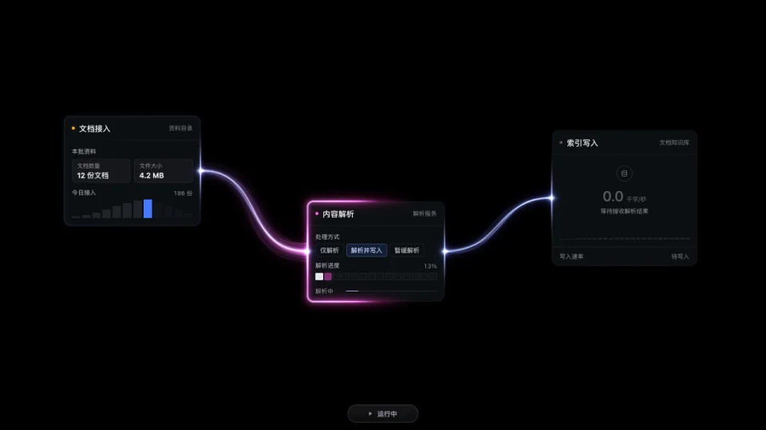
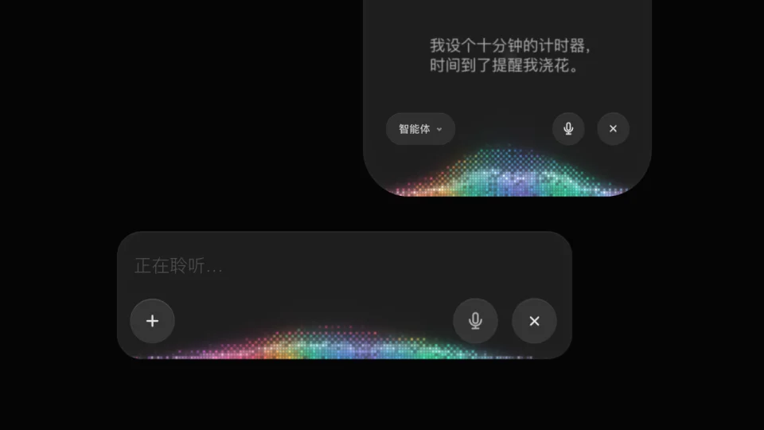

<h1 align="center">
  
</h1>

<strong>开源 UI 微交互资料库</strong>

从滑块、状态提示到加载与手势确认，每个案例都提供界面源码与动效拆解。

  <strong><a href="https://yogupro.github.io/open-motion/">在线站点</a></strong> · <a href="#案例画廊">案例画廊</a> · <a href="#资料索引">资料索引</a> · <a href="#关于智慧力量">关于智慧力量</a> · <a href="./LICENSE">MIT</a>

> 案例素材来自 X（原 Twitter），原创设计归原作者。OpenMotion 提供案例复现与动效拆解，供学习交流。

## 案例画廊

<table>
  <tr valign="top">
    <td width="50%">
       
      <strong>液化边缘吸附</strong> 
      拖动胶囊离开屏幕边缘，观察液桥拉伸、断开与重新吸附。 
      <a href="https://yogupro.github.io/open-motion/05-liquid-dock/index.html">在线体验</a> · <a href="./05-liquid-dock/README.md">案例资料</a>
    </td>
    <td width="50%">
       
      <strong>Before / After 拖拽对比</strong> 
      拖动同一条分割线，比较回弹、惯性与磁吸三种手感。 
      <a href="https://yogupro.github.io/open-motion/06-before-after-physics/index.html">在线体验</a> · <a href="./06-before-after-physics/README.md">案例资料</a>
    </td>
  </tr>
  <tr valign="top">
    <td width="50%">
       
      <strong>患者流转漏斗</strong> 
      切换诊疗场景，观察漏斗轮廓、数字与粒子同步过渡。 
      <a href="https://yogupro.github.io/open-motion/07-patient-funnel-webgl/index.html">在线体验</a> · <a href="./07-patient-funnel-webgl/README.md">案例资料</a>
    </td>
    <td width="50%">
       
      <strong>Agent Orb</strong> 
      用同一个 WebGL 点阵球表达六种 Agent 状态。 
      <a href="https://yogupro.github.io/open-motion/02-agent-orb/">在线体验</a> · <a href="./02-agent-orb/README.md">案例资料</a>
    </td>
  </tr>
  <tr valign="top">
    <td width="50%">
       
      <strong>Codex Ultra 能量滑轨</strong> 
      弹簧旋钮、极光填充与挡位粒子反馈。 
      <a href="https://yogupro.github.io/open-motion/01-codex-ultra-slider/codex-ultra-slider.html">在线体验</a> · <a href="./01-codex-ultra-slider/README.md">案例资料</a>
    </td>
    <td width="50%">
       
      <strong>导出光带</strong> 
      暖色光带上移，文件摘要逐行恢复清晰。 
      <a href="https://yogupro.github.io/open-motion/03-webgl-loading/">在线体验</a> · <a href="./03-webgl-loading/README.md">案例资料</a>
    </td>
  </tr>
  <tr valign="top">
    <td width="50%">
       
      <strong>进度线的暂停与回弹</strong> 
      暂停时进度线折起，继续时从折痕处展开并接着前进。 
      <a href="https://yogupro.github.io/open-motion/08-kippe-progress-motion/index.html">在线体验</a> · <a href="./08-kippe-progress-motion/README.md">案例资料</a>
    </td>
    <td width="50%">
       
      <strong>抠图粒子消散与高光描边</strong> 
      照片背景碎成方块散开，主体抬起并浮现贴纸白边。 
      <a href="https://yogupro.github.io/open-motion/09-cutout-particles-webgl/index.html">在线体验</a> · <a href="./09-cutout-particles-webgl/README.md">案例资料</a>
    </td>
  </tr>
  <tr valign="top">
    <td width="50%">
       
      <strong>流光棱镜微交互按钮</strong> 
      悬停点亮棱镜边框，按下时心形图标弹起。 
      <a href="https://yogupro.github.io/open-motion/10-tactile-button/index.html">在线体验</a> · <a href="./10-tactile-button/README.md">案例资料</a>
    </td>
    <td width="50%">
       
      <strong>上滑转账</strong> 
      上滑越过确认阈值，松手后衔接光箭与折射回执。 
      <a href="https://yogupro.github.io/open-motion/04-swipe-send/">在线体验</a> · <a href="./04-swipe-send/README.md">案例资料</a>
    </td>
  </tr>
  <tr valign="top">
    <td width="50%">
       
      <strong>文档索引工作流</strong> 
      启动工作流后，数据包沿连线依次经过接入、解析和索引写入。 
      <a href="https://yogupro.github.io/open-motion/11-anuar-node-connections/index.html">在线体验</a> · <a href="./11-anuar-node-connections/README.md">案例资料</a>
    </td>
    <td width="50%">
       
      <strong>语音助手 · 粒子声波</strong> 
      两个面板独立演示聆听、思考与粒子声波。 
      <a href="https://yogupro.github.io/open-motion/12-voice-particles-webgl/index.html">在线体验</a> · <a href="./12-voice-particles-webgl/README.md">案例资料</a>
    </td>
  </tr>
</table>

## 资料索引

| 案例 | 技术 | 界面源码 | 案例资料 |
| --- | --- | --- | --- |
| 液化边缘吸附 | WebGL 2D SDF | [界面入口](./05-liquid-dock/index.html) | [README](./05-liquid-dock/README.md) |
| Before / After 拖拽对比 | SVG 与弹簧物理 | [界面入口](./06-before-after-physics/index.html) | [README](./06-before-after-physics/README.md) |
| 患者流转漏斗 | WebGL 粒子 | [界面入口](./07-patient-funnel-webgl/index.html) | [README](./07-patient-funnel-webgl/README.md) |
| Agent Orb | WebGL 点阵球 | [界面入口](./02-agent-orb/index.html) | [README](./02-agent-orb/README.md) |
| Codex Ultra 能量滑轨 | 弹簧与 WebGL | [界面入口](./01-codex-ultra-slider/codex-ultra-slider.html) | [README](./01-codex-ultra-slider/README.md) · [原理速查手册](./01-codex-ultra-slider/Codex-Ultra-微交互原理速查手册.md) |
| 导出光带 | WebGL 着色器 | [单文件 HTML](./03-webgl-loading/index.html) | [README](./03-webgl-loading/README.md) · [原理速查手册](./03-webgl-loading/导出光带-微交互原理速查手册.md) |
| 进度线的暂停与回弹 | SVG 与弹簧 | [界面入口](./08-kippe-progress-motion/index.html) | [README](./08-kippe-progress-motion/README.md) |
| 抠图粒子消散与高光描边 | WebGL 2 粒子 | [界面入口](./09-cutout-particles-webgl/index.html) | [README](./09-cutout-particles-webgl/README.md) |
| 流光棱镜微交互按钮 | CSS Houdini | [界面入口](./10-tactile-button/index.html) | [README](./10-tactile-button/README.md) |
| 上滑转账 | 手势与 WebGL | [界面入口](./04-swipe-send/index.html) | [README](./04-swipe-send/README.md) · [原理速查手册](./04-swipe-send/上滑转账-微交互原理速查手册.md) |
| 文档索引工作流 | Vue Flow 与 WebGL | [界面入口](./11-anuar-node-connections/index.html) | [README](./11-anuar-node-connections/README.md) |
| 语音助手 · 粒子声波 | WebGL 粒子 | [界面入口](./12-voice-particles-webgl/index.html) | [README](./12-voice-particles-webgl/README.md) |

## 关于智慧力量

杭州智慧力量科技有限公司专注打造 AI 产品，服务个人与团队的知识工作、内容生产和业务流程。

OpenMotion 由智慧力量维护。

[智慧力量官网](https://yogu.pro)
